# nxe-plugins

Audio plugins in Rust, built on [truce](https://github.com/truce-audio/truce)
with an [egui](https://github.com/emilk/egui) UI. Every plugin exports
**CLAP**, **VST3** and **AU**, and they are released a series at a time.

<p align="center">
  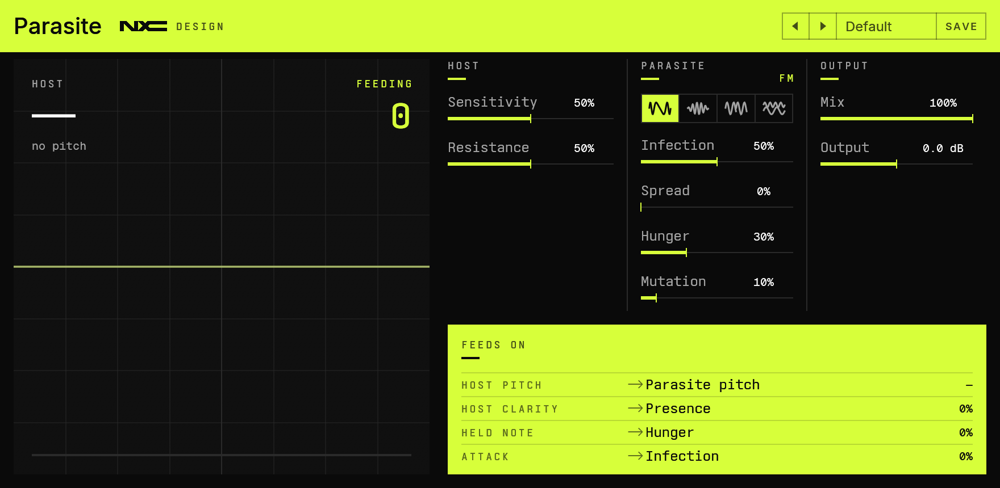
</p>

## Download

One release per series. Each carries an installer per platform, a zip for
the whole series, and a zip per plugin.

<!-- downloads:start -->
| Series | What it is | Latest | macOS | Windows | All releases |
|---|---|---|---|---|---|
| [**Basic**](#basic) | Tools for a vocal and the mix | [`basic-2026.11-beta.2`](https://github.com/narusenia/nxe-plugins/releases/tag/basic-2026.11-beta.2) | [installer](https://github.com/narusenia/nxe-plugins/releases/download/basic-2026.11-beta.2/nxe-basic-2026.11-beta.2-macos-installer.pkg) · [zip](https://github.com/narusenia/nxe-plugins/releases/download/basic-2026.11-beta.2/nxe-basic-2026.11-beta.2-macos.zip) | [installer](https://github.com/narusenia/nxe-plugins/releases/download/basic-2026.11-beta.2/nxe-basic-2026.11-beta.2-windows-installer.exe) · [zip](https://github.com/narusenia/nxe-plugins/releases/download/basic-2026.11-beta.2/nxe-basic-2026.11-beta.2-windows.zip) | [Basic](https://github.com/narusenia/nxe-plugins/releases?q=basic-&expanded=true) |
| [**Peek**](#peek) | Meters that never touch the sound | [`peek-2026.11-beta.2`](https://github.com/narusenia/nxe-plugins/releases/tag/peek-2026.11-beta.2) | [installer](https://github.com/narusenia/nxe-plugins/releases/download/peek-2026.11-beta.2/nxe-peek-2026.11-beta.2-macos-installer.pkg) · [zip](https://github.com/narusenia/nxe-plugins/releases/download/peek-2026.11-beta.2/nxe-peek-2026.11-beta.2-macos.zip) | [installer](https://github.com/narusenia/nxe-plugins/releases/download/peek-2026.11-beta.2/nxe-peek-2026.11-beta.2-windows-installer.exe) · [zip](https://github.com/narusenia/nxe-plugins/releases/download/peek-2026.11-beta.2/nxe-peek-2026.11-beta.2-windows.zip) | [Peek](https://github.com/narusenia/nxe-plugins/releases?q=peek-&expanded=true) |
| [**Kit**](#kit) | Small sound-design tools, a few knobs each | [`kit-2026.11-beta.2`](https://github.com/narusenia/nxe-plugins/releases/tag/kit-2026.11-beta.2) | [installer](https://github.com/narusenia/nxe-plugins/releases/download/kit-2026.11-beta.2/nxe-kit-2026.11-beta.2-macos-installer.pkg) · [zip](https://github.com/narusenia/nxe-plugins/releases/download/kit-2026.11-beta.2/nxe-kit-2026.11-beta.2-macos.zip) | [installer](https://github.com/narusenia/nxe-plugins/releases/download/kit-2026.11-beta.2/nxe-kit-2026.11-beta.2-windows-installer.exe) · [zip](https://github.com/narusenia/nxe-plugins/releases/download/kit-2026.11-beta.2/nxe-kit-2026.11-beta.2-windows.zip) | [Kit](https://github.com/narusenia/nxe-plugins/releases?q=kit-&expanded=true) |
| [**Design**](#design) | Tools that remake a sound | [`design-2026.11-beta.1`](https://github.com/narusenia/nxe-plugins/releases/tag/design-2026.11-beta.1) | [installer](https://github.com/narusenia/nxe-plugins/releases/download/design-2026.11-beta.1/nxe-design-2026.11-beta.1-macos-installer.pkg) · [zip](https://github.com/narusenia/nxe-plugins/releases/download/design-2026.11-beta.1/nxe-design-2026.11-beta.1-macos.zip) | [installer](https://github.com/narusenia/nxe-plugins/releases/download/design-2026.11-beta.1/nxe-design-2026.11-beta.1-windows-installer.exe) · [zip](https://github.com/narusenia/nxe-plugins/releases/download/design-2026.11-beta.1/nxe-design-2026.11-beta.1-windows.zip) | [Design](https://github.com/narusenia/nxe-plugins/releases?q=design-&expanded=true) |
<!-- downloads:end -->

Every release is on the [releases page](https://github.com/narusenia/nxe-plugins/releases).
The builds are not signed: see [Installing](#installing) for the first run.

## Basic

Six plugins for a vocal and the mix, each a focused tool:
[what the series is and how the plugins fit together](docs/series/basic.md).

<p>
  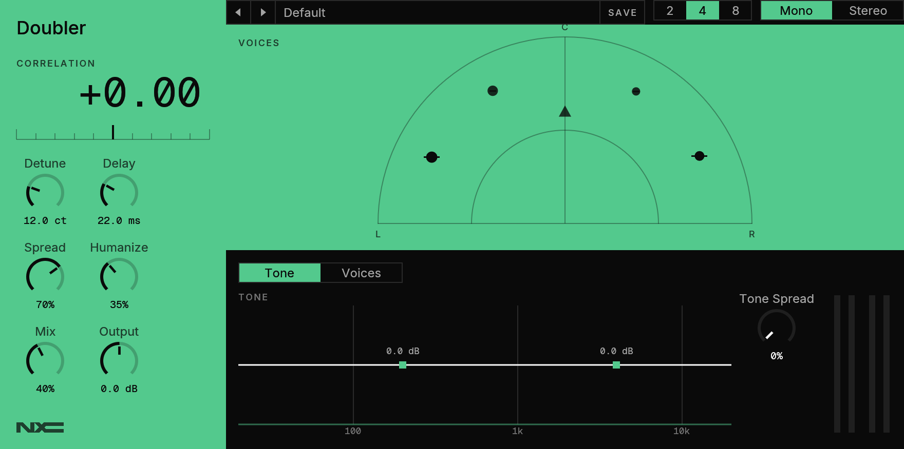
  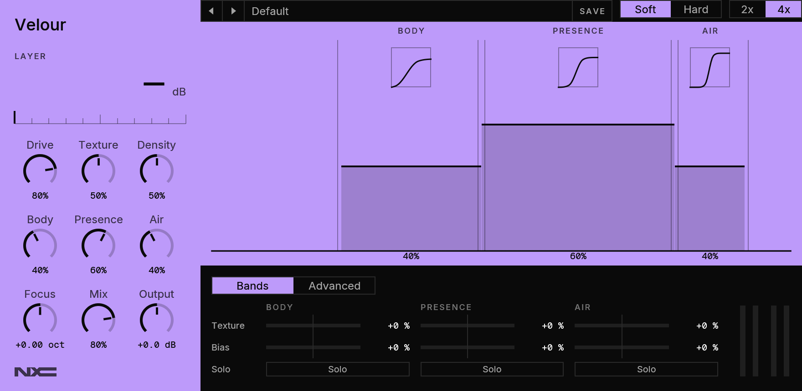
  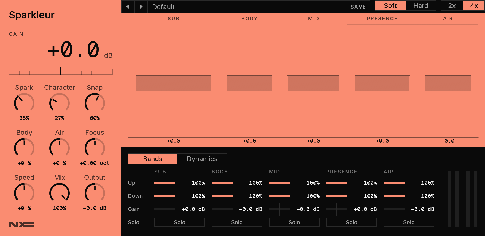
  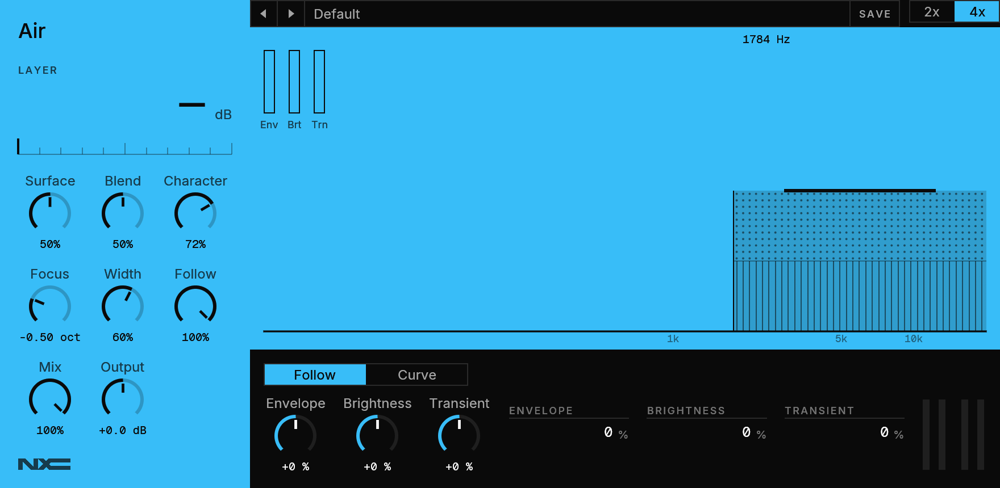
  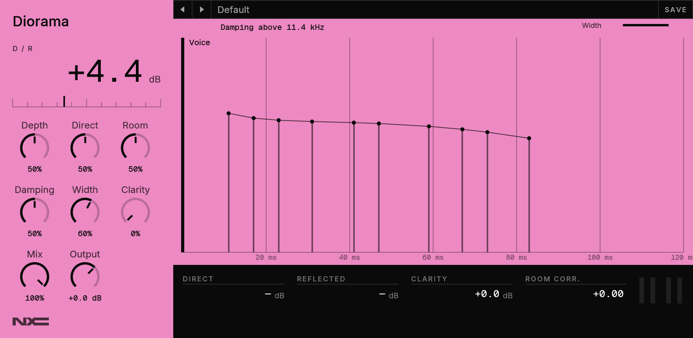
  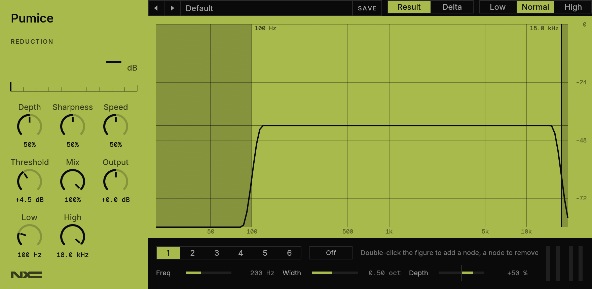
</p>

| Plugin | What it is |
|---|---|
| [Doubler 2](plugins/doubler/docs/requirements/REQ-DBL.md) | Multi-voice doubler — 2, 4 or 8 detuned, delayed, humanized voices from one source |
| [Velour 2](plugins/velour/docs/requirements/REQ-VEL.md) | Vocal presence saturator — three parallel harmonic generators added to an untouched dry path |
| [Sparkleur 2](plugins/sparkleur/docs/requirements/REQ-SPK.md) | Multiband dynamics with a transient-gated harmonic generator — five bands, upward and downward |
| [Air 2](plugins/air/docs/requirements/REQ-AIR.md) | Signal-driven texture generator — harmonics and noise placed where the source is not |
| [Diorama 2](plugins/diorama/docs/requirements/REQ-DIO.md) | A vocal's distance as one knob — early reflections and a processed direct path, no reverb tail |
| [Pumice](plugins/pumice/docs/requirements/REQ-PUM.md) | Dynamic resonance suppression for a single vocal, with six nodes you place by hand |

**They are meant to be opened side by side.** One width, one typeface, one
accent per plugin from a family that varies only in hue, and the same shape in
every window.

## Peek

Meters. None of them touches the signal: seven single meters, and Peek, which
shows them all in one window you can resize.

<p>
  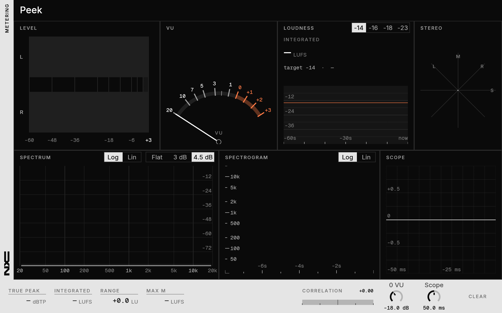
</p>
<p>
  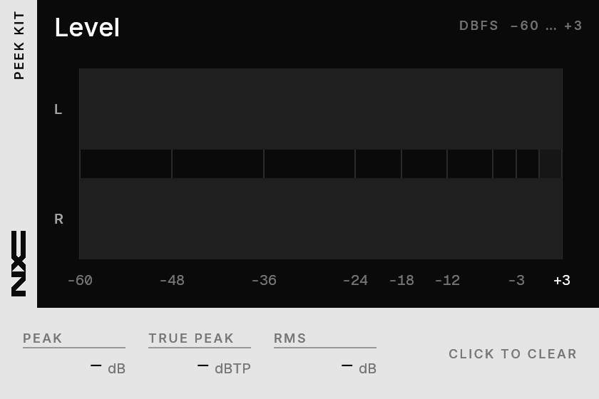
  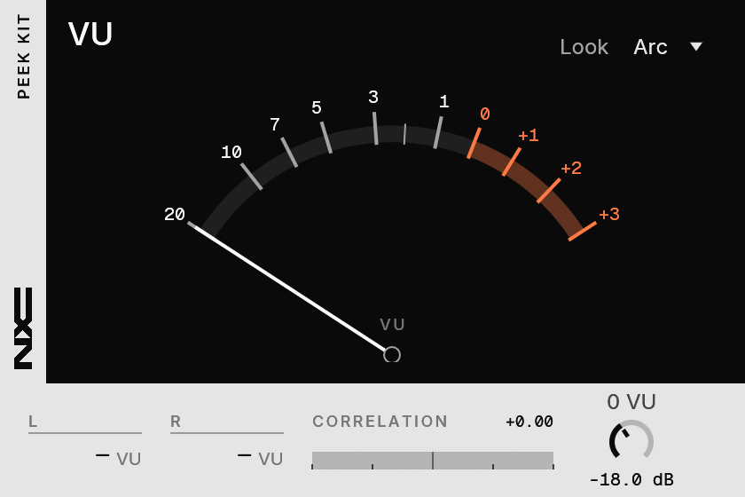
  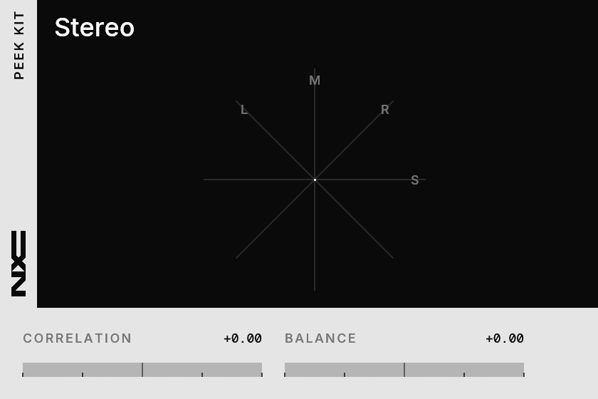
  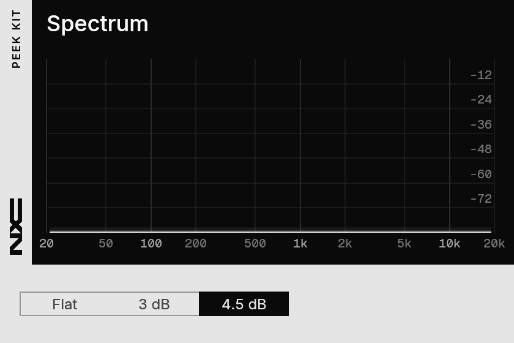
  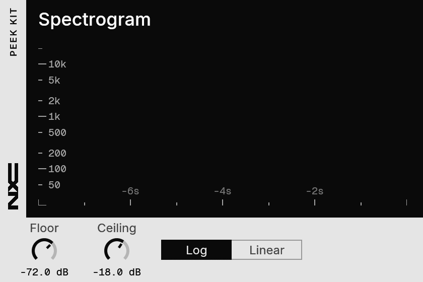
  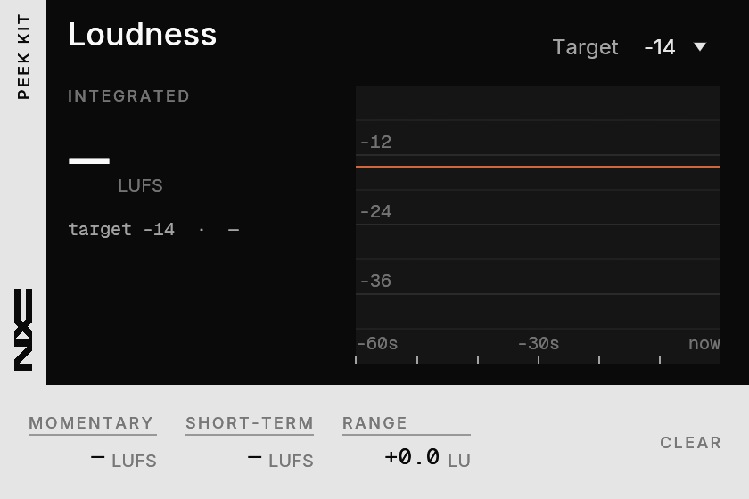
  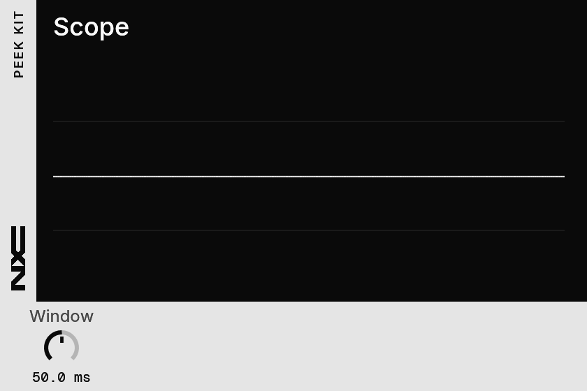
</p>

| Plugin | What it is |
|---|---|
| Peek Level | Peak, true peak and RMS, per channel |
| Peek VU | A VU meter, as a needle or as bars |
| Peek Stereo | A goniometer, with correlation and balance |
| Peek Spectrum | A spectrum analyser |
| Peek Spectrogram | A scrolling spectrogram |
| Peek Loudness | Loudness after BS.1770 and EBU R 128 |
| Peek Scope | An oscilloscope |
| Peek | Every Peek meter in one resizable window |

## Kit

Small plugins, two to four knobs each, that each take one idea from a larger
plugin and do only that. Acid green ones are cut from Design, aqua ones from
Colour.

<p>
  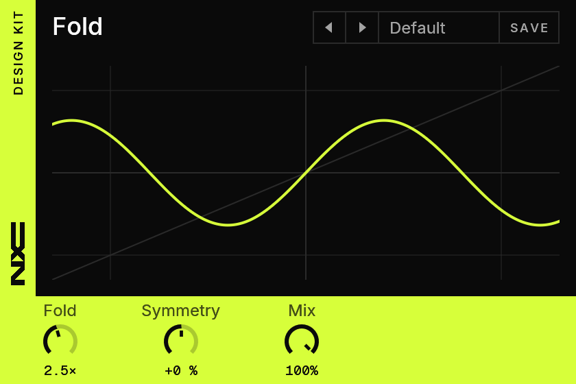
  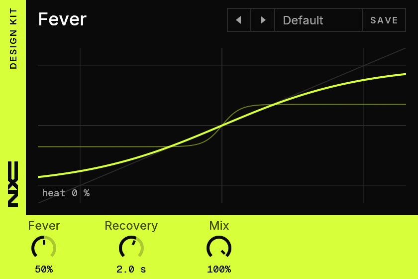
  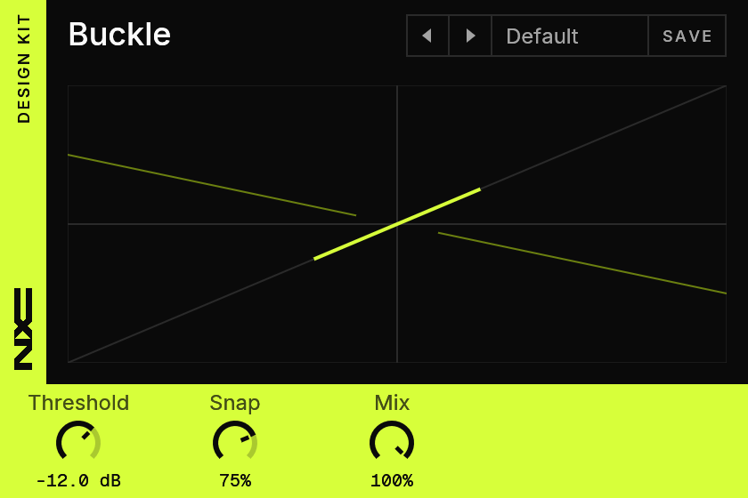
  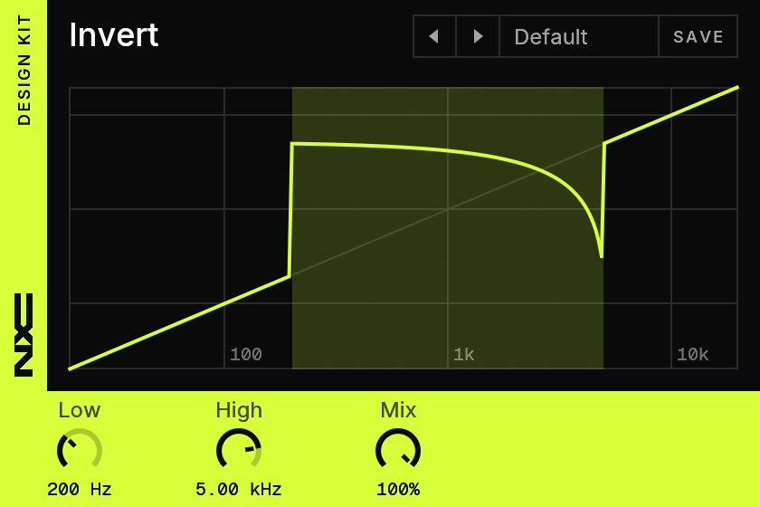
  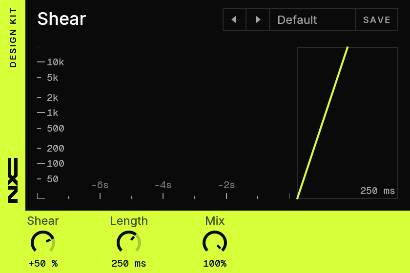
  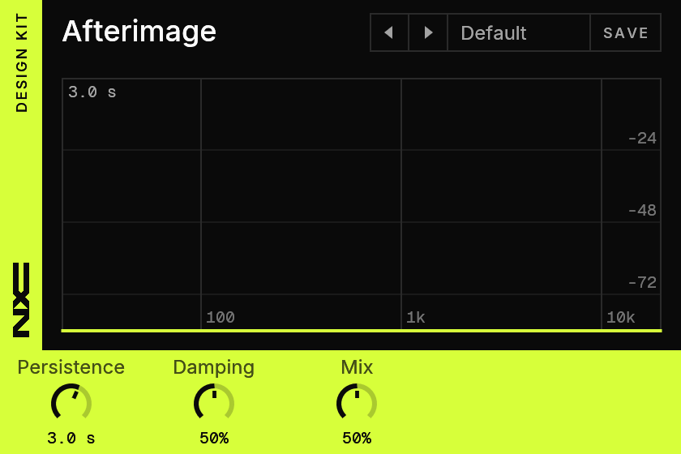
  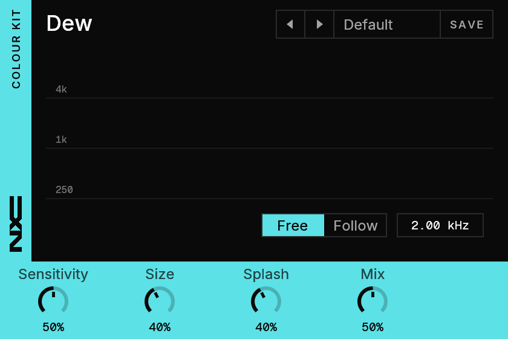
</p>

| Plugin | What it is |
|---|---|
| Fold | A sine wavefolder |
| Fever | A saturator that heats up and wanders |
| Buckle | A waveform that turns over past a threshold |
| Invert | The spectrum turned upside down between two frequencies |
| Shear | Each frequency delayed by its own amount |
| Afterimage | What was loud stays on as a fading trace |
| Dew | Water drops on every attack, tuned freely or to the input's harmonics (from the next Kit release) |

## Design

Plugins that remake a sound rather than shape it. The first is out; more follow.

| Plugin | What it is |
|---|---|
| [Parasite](plugins/parasite/docs/implementation/parasite-plan.md) | An oscillator that follows the input's pitch and feeds on it — four ways (FM, Ring, Sync, Voice) — and takes over the sound on held notes |

What comes next, and why in that order, is in
[`docs/implementation/series-plan.md`](docs/implementation/series-plan.md).

## Installing

**Formats.** CLAP, VST3 and AU v2 on macOS (Apple Silicon and Intel); CLAP and
VST3 on Windows. Linux is not built from 2.0; the 0.x releases had it.

**The easy way: the series installer.** It lets you pick plugins and
formats. It is not signed, so the first time:

- **macOS:** open it, close the warning, then go to *System Settings → Privacy &
  Security* and click *Open Anyway*. Plugins it installs need no `xattr`.
- **Windows:** SmartScreen warns; choose *More info → Run anyway*.

**By hand:** unpack a zip and copy the bundles into:

| | CLAP | VST3 | AU |
|---|---|---|---|
| macOS | `~/Library/Audio/Plug-Ins/CLAP` | `~/Library/Audio/Plug-Ins/VST3` | `~/Library/Audio/Plug-Ins/Components` |
| Windows | `%COMMONPROGRAMFILES%\CLAP` | `%COMMONPROGRAMFILES%\VST3` | — |

**macOS builds are not signed or notarized.** The first time you load one
copied by hand, Gatekeeper will refuse it. Clear the quarantine attribute from
the bundles you copied, for example the Basic series:

```bash
cd ~/Library/Audio/Plug-Ins
for name in "Doubler 2" "Sparkleur 2" "Velour 2" "Air 2" "Diorama 2" "Pumice"; do
  xattr -dr com.apple.quarantine "CLAP/$name.clap" "VST3/$name.vst3" "Components/$name.component"
done
```

**Tags.** A release is tagged `<series>-<YYYY.MM>[-beta.N]` (`basic-2026.11-beta.1`).
The 0.x releases before them were one per plugin, tagged `<plugin>-v<version>`,
and were built on nih-plug and Vizia.

## Building

Requires Rust 1.95 or newer. [mise](https://mise.jdx.dev/) manages the
toolchain and tasks.

```bash
mise trust                  # once, after cloning
mise run check              # fmt + clippy + tests
mise run install doubler    # build, then install CLAP, VST3 and AU into the user plugin folders
mise run gallery            # run the shared UI widget gallery as a desktop app
```

Working on this repository? Start with [`AGENTS.md`](AGENTS.md) for the layout
and the rules, [`docs/README.md`](docs/README.md) for which document plays which
role, and [`crates/nxe-egui/README.md`](crates/nxe-egui/README.md) if you are
touching the interface.

## License

**MIT OR Apache-2.0**, every crate and every bundle from 2.0. The 0.x bundles
were **GPL-3.0-only**, because nih-plug links `vst3-sys` and that is GPLv3;
[LICENSE-GPL-3.0](LICENSE-GPL-3.0) stays for them.

[`LICENSING.md`](LICENSING.md) has the per-crate table and the reasoning.
[LICENSE-MIT](LICENSE-MIT) / [LICENSE-APACHE](LICENSE-APACHE).
