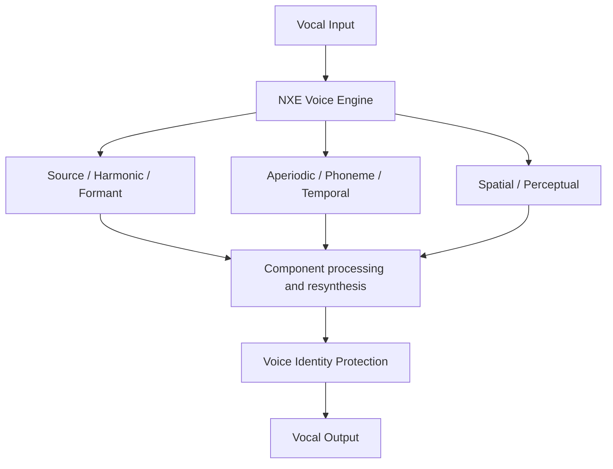

# NXE Articulate — 製品企画集

*Voice, Beyond Clarity.*

> 企画段階・2026-11-25。初期案と個別シリーズの追加案を統合。名称は仮称。

## 1. シリーズの思想

理想の声の質感を追求する。透明なのにセンターに芯があり、太いのに曇らず、華やかなのに刺さらない声を目指す。歌手の個性・音程・発音・表現を保ち、単なる自動ミックスや声の模倣とは区別する。

## 2. メインラインナップ

| 製品 | コンセプト |
|---|---|
| **Core** | 声の芯・倍音密度 |
| **Lustre** | 艶・華やかさ・透明感 |
| **Velour** | 温かく滑らかな質感 |
| **Embodiment** | 身体的な実体感・胴鳴り |
| **Vocalis** | 声帯励起特性の操作 |
| **Phonetic** | 母音・子音などの発音別処理 |
| **Sibilis** | 歯擦音の再形成 |
| **Respire** | 息成分の質感 |
| **Silhouette** | フォルマント・共振構造 |
| **Intimate** | 近接感・距離 |
| **Anchor** | センター定位と存在感 |
| **Poise** | 音節単位のダイナミクス |
| **Cadence** | フレーズ単位の音量制御 |
| **Persona** | 理想の声の質感を設計 |
| **Portrait** | 統合型ボーカルサウンドデザイナー |
| **Overtone** | 選択的な自然な倍音生成 |
| **Diction** | 言葉の明瞭度 |
| **Ensemble** | 自然なダブル・ハーモニー |
| **Aureole** | 声に特化した空間・残響 |

## 3. 個別製品の技術構想

### Core — Vocal Harmonic Density Processor
基音推定・倍音トラッキング、調和/非調和分離、選択的再合成、調和成分限定アップワードコンプレッション、フォルマントを考慮した共振抑制。Density / Body / Solidity / Focus / Clarity / Mud Guard / Stability。モノ素材を不要にステレオ化しない。なとり『Puppet』のようなセンターの密度感は目標例であり、音源の解析結果ではない。

### Lustre — Vocal Brilliance Designer
周期成分に追従して倍音を生成し、母音の艶と子音の鋭さを分離。Glow / Brilliance / Air / Silk / Definition / Fragility / Harsh Guard。BasicのSparkluerと異なり、声に特化する。

### Vocalis — Glottal Source Designer
Source-Filterモデル `S(ω) ≈ G(ω)V(ω)R(ω)` を利用。逆フィルタリング等で励起信号を推定し、Closure / Tension / Breathiness / Press / Texture / Harmonic Tilt / Softness を操作。録音から声帯信号を完全に同定することはできない。

### Embodiment — Vocal Body Architect
低次倍音と母音に追従する共振を補強。Chest / Weight / Depth / Fullness / Resonance / Mud Protection。Coreより身体的な厚みに特化。

### Phonetic — Phoneme-Aware Vocal Processor
母音、子音、歯擦音、破裂音、鼻音、息の確率的分類とソフトマスク。成分別EQ・圧縮・倍音処理。特徴量ベースと軽量MLモードを検討。言語・歌唱スタイルへの汎化と分類境界の平滑化が課題。

### Sibilis — Sibilance Reconstruction Engine
歯擦音のエネルギーだけでなく周波数分布と時間形状を調整する。Sharpness / Softness / Grain / Duration / Definition / Reconstruction。発音識別性を保持。

### Respire — Breath Texture Designer
非周期成分・ブレスを推定。Breath / Softness / Airflow / Intimacy / Texture / Isolation。発声と歯擦音の誤分離を抑える。

### Silhouette — Vocal Resonance Sculptor
フォルマントごとの位置・幅・強度を操作し、母音の識別性を維持する。LPCやスペクトル包絡推定を候補とする。

### Intimate — Vocal Proximity Engine
Distance / Directness / Breath Presence / Proximity Effect / Detail / Openness。直接音、初期反射、低次倍音、微細ダイナミクスを連動。Perspectの声専用版。

### Poise / Cadence — Musical Vocal Dynamics
Poiseは音節・音符単位、Cadenceはフレーズ単位で聴感上の音量を整える。表現の起伏を残し、コンプレッサーと別階層で動作。先読みまたはオフライン解析でオートメーション生成も検討。

### Persona — Vocal Aesthetic Designer
Warmth / Density / Clarity / Air / Intimacy / Edge / Silk / Weight の目標を指定し、複数DSPを連動。目的関数 `||F(Pθ(x))-t||² + λ D(x,Pθ(x))` を最小化する構想。Dense & Clear、Warm Velvet、Glass Air、Intimate R&B、Modern Pop、Dark & Solid、Raw & Emotionalなどのプリセット。Reference Aesthetic Matchingでは声の模倣ではなく密度、倍音傾斜、近接感、ダイナミクス等を参照する。伴奏込みの素材では分離精度と歌手固有特性の区別が課題。

### Portrait — Complete Vocal Architecture
Core、Lustre、Vocalis、Embodiment、Phonetic、Respire、Poise、Cadence等を統合し、Personaの目標制御を利用する。単体製品のDSPを共有し、過剰処理を抑制する。

## 4. 特化型・追加製品

| 製品 | 処理対象・コンセプト |
|---|---|
| **Marrow** | 低次倍音だけを補強 |
| **Veil** | 膜がかかったような曇りの除去 |
| **Gossamer** | 薄く繊細で透明な質感 |
| **Caress** | 柔らかな近接感 |
| **Ember** | 温かい中域倍音 |
| **Opaline** | 透明感と柔らかな光沢 |
| **Grain** | 微細なザラつき・粒状感 |
| **Friction** | 掠れ声や粗さ |
| **Blooming** | 母音が開く響き |
| **Vivid** | 生命感・微細なダイナミクス |
| **Murmur** | 弱い歌唱・ウィスパー |
| **Crisp** | 子音の輪郭 |
| **Chest** | 胸に響くような厚み |
| **Undertone** | 低次倍音・サブハーモニクス |
| **Pliant** | アタックと減衰の柔軟性 |
| **Inhale** | ブレスの長さ・輪郭 |
| **Vocal Bloom** | 発音後に倍音が自然に開く |
| **Aftervoice** | 音色に追従する微細な残響 |
| **Silken** | 細かなザラつきを滑らかにする |
| **Proximity** | マイク近接効果の調整 |
| **Whisper** | 息混じりの歌声の空気感 |
| **Humanize** | 自然な揺らぎの補強 |

## 5. 共通技術・アーキテクチャ

従来DSPを中心とし、音素分類や声帯特性推定に必要に応じMLを利用する。推定信頼度に応じて処理量を制限し、低信頼時は原音へ戻す。位相整合、音程・発音保持、レイテンシー、差分試聴、ラウドネスマッチを共通化する。

## 6. 開発ロードマップ

| 順位 | 製品 | 難易度 |
|---|---|---|
| 1 | Core | 中〜高 |
| 2 | Lustre | 中〜高 |
| 3 | Veil | 中 |
| 4 | Embodiment | 中〜高 |
| 5 | Respire | 高 |
| 6 | Sibilis | 高 |
| 7 | Poise | 高 |
| 8 | Silhouette | 高 |
| 9 | Phonetic | 非常に高 |
| 10 | Vocalis | 非常に高 |
| 11 | Persona | 非常に高 |
| 12 | Portrait | 非常に高 |

代表製品：Core（The Substance of Voice.）、Lustre（Light Within the Voice.）、Vocalis（Beyond the Vocal Source.）、Persona（Your Voice, Your Aesthetic.）。

## 7. 検証事項・製品間の整理

Velour/Silken、Respire/Inhale/Whisper、Embodiment/Chest/Marrow、Lustre/Opaline、Intimate/Proximity/Caressなどは統合候補。Blooming/Vocal Bloomは差分を明確化する。歌唱音声での推定性能、歌手らしさ、歯擦音・破裂音の保護をラウドネス一致の試聴で評価する。

名称・商標・既存製品との重複および技術的新規性は未調査。難易度・優先度は企画段階の相対評価。DSPの効果は実測・試聴で検証する。
