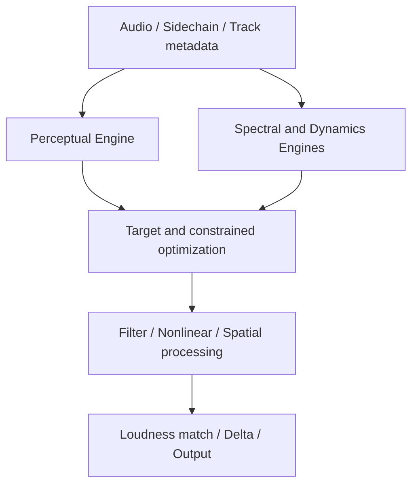

# NXE Polish — 製品企画集

*Refine Every Detail.*

> 企画段階・2026-11-25。初期案と個別シリーズの追加案を統合。名称は仮称。

## 1. シリーズの思想

ミックス・マスタリングの完成度を追求する。一般的なEQやコンプレッサーはProに任せ、密度・透明感・奥行き・重量感・一体感など、感覚的な目標を直接操作する。音量差による錯覚を避け、原音の個性を保護する。

## 2. メインラインナップ

| 製品 | コンセプト |
|---|---|
| **Equilibria** | 聴感ベースの動的トーナルバランス補正 |
| **Interstice** | 複数トラック間のマスキング最適化 |
| **Density** | 音圧と独立した聴感上の密度 |
| **Perspect** | 前後感・距離・存在感 |
| **Coalesce** | バスの一体感と質感の統合 |
| **Lucent** | 曇り・濁りの選択的除去 |
| **Inertia** | 低域の重量感と制動 |
| **Contrast** | 楽器間の質感・ダイナミックコントラスト |
| **Vellum** | 微細な倍音と最終仕上げ |
| **Apex** | 聴感最適化マスタリングリミッター |
| **Contour** | ミックス全体のダイナミクス形状 |
| **Axis** | ステレオ重心と安定性 |
| **Relief** | 共振・耳に刺さる成分の抑制 |
| **Translation** | 再生環境間の聴こえ方の分析 |
| **Finalize** | 統合型マスタリングプロセッサー |

## 3. 個別製品の技術構想

### Density — Perceptual Mass Processor
音量を上げずに音の塊を作る。マルチ解像度STFT、調和成分補強、選択的アップワードコンプレッション、時間周波数エネルギー最適化。Mass / Fill / Solidity / Continuity / Transparency / Transient Preserve。ラウドネスマッチを必須とする。

### Perspect — Depth & Presence Processor
Distance / Presence / Directness / Diffusion / Proximity / Air Absorption。距離依存フィルター、初期反射、直接音対残響比、トランジェント制御を連動。残響や音量だけに頼らない奥行きを目指す。

### Interstice — Multi-Track Coexistence Engine
インスタンス間で解析情報を共有し、優先度に従って複数トラックを相互補正する。Priority / Separation / Reciprocity / Identity / Masking Threshold。目的関数は `L_masking + λ L_distortion + μ L_temporal`。原音変化と補正の時間的不安定性を制限。DAWのプロセス分離・PDC・リアルタイム安全な通信が課題。

### Lucent — Selective Transparency Processor
不要な共振・低中域の蓄積・非調和成分を選択的に抑制。Transparency / Deveil / Definition / Resonance / Warmth Preserve / Detail Recovery。共振抑制だけでなく透明感を評価する。

### Inertia — Low-End Architecture
Mass / Punch / Elasticity / Damping / Anchor。低域のエンベロープ、位相、倍音、持続と収束を制御。重量感とタイトさを独立させる。

### Vellum — Mastering Texture Processor
Silk / Grain / Glow / Cohesion / Depth / Finish。微細な非線形処理とダイナミクスを組み合わせ、繊細な質感を付与する。

### Apex — Perceptual Mastering Limiter
True Peak制御、先読み、帯域依存リリース、トランジェント保持、クリッピングとのハイブリッド、歪み可視化。ラウドネス増加時の知覚損失を最小化する。

### Equilibria — Perceptual Tonal Balancer
ERB帯域解析、心理音響モデル、長短時間統計、動的EQ、時間正則化。Balance / Warmth / Brilliance / Weight / Adaptation / Character。

### Coalesce — Adaptive Bus Cohesion
エンベロープ相関、帯域間連動ダイナミクス、共通倍音生成、適応型サチュレーションで個性を保った一体感を作る。

## 4. 特化型・追加製品

| 製品 | 処理対象・コンセプト |
|---|---|
| **Weave** | 楽器の周波数構造を噛み合わせる |
| **Emphasis** | 主役と脇役のコントラスト |
| **Microdynamics** | 微細なダイナミクスの回復 |
| **Headroom** | 聴感を保ちながらピークを削減 |
| **Symbiosis** | KickとBassの時間・位相・周波数の共存 |
| **Centerline** | ミックス中央のエネルギーバランス |
| **Sustain** | 音量を上げず持続感を調整 |
| **Lacuna** | 不足したスペクトル成分の推定・補強 |
| **Granularity** | 細かな粒立ち |
| **Viscosity** | 粘り・滑らかな繋がり |
| **Decant** | 調和成分を保護しながら濁りを除去 |
| **Sculpture** | トランジェントと持続音の音色を独立処理 |
| **Accord** | 調性を考慮した共振補正 |
| **Parallax** | 周波数別の奥行き |
| **Equinox** | Mid/Sideの聴感上のバランス |
| **Continuum** | 微細な音量変動と持続感 |
| **Tension** | 緊張感とダイナミックコントラスト |
| **Resolve** | 分離感・解像感 |
| **Imprint** | リファレンスの音響的質感の転写 |
| **Margin** | 音色を保ちヘッドルーム確保 |
| **Residual** | 処理による損失の分析・回復 |

## 5. 共通技術・アーキテクチャ

共通品質基準：オートゲイン、ラウドネスマッチ、差分試聴、過剰処理防止、低遅延・高品質モード、Mix/Master切替、モノ互換・位相表示。音響評価にはERB帯域、マスキング、ラウドネス、相関、トランジェントを用いる。

## 6. 開発ロードマップ

推奨順序：Density → Lucent → Perspect → Vellum → Inertia → Interstice → Apex。DensityとLucentで基本的な知覚モデルを検証し、Intersticeで複数インスタンス最適化に進む。ApexはTrue Peakと音質評価の検証後に製品化。フラッグシップ候補はInterstice。

## 7. 検証事項・製品間の整理

Headroom/Margin、Lucent/Decant/Relief、Contrast/Emphasis、Inertia/Symbiosisは重複を整理する。ResidualはProにも同名案があるため統合または改名候補。評価はラウドネスを合わせたブラインド試聴とモノ互換性・歪み測定で行う。

名称・商標・既存製品との重複および技術的新規性は未調査。難易度・優先度は企画段階の相対評価。DSPの効果は実測・試聴で検証する。
