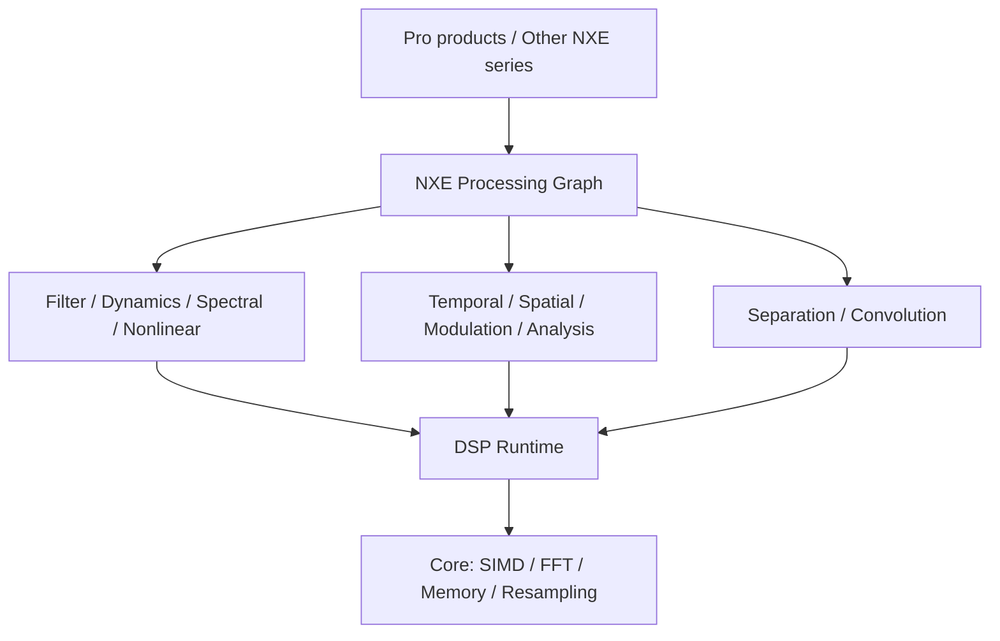

# NXE Pro — 製品企画集

*No Limits to Sound.*

> 企画段階・2026-11-25。初期案と個別シリーズの追加案を統合。名称は仮称。

## 1. シリーズの思想

汎用性と高度な音響処理の自由度を追求する。Basicの単なる上位版ではなく、処理の検出器、伝達関数、信号経路、条件、変調を設計できる環境。実用的な操作と研究用途を両立する。

## 2. メインラインナップ

| 製品 | コンセプト |
|---|---|
| **Vector** | 統合EQ・条件付き周波数処理 |
| **Impulse** | 汎用ダイナミクス設計 |
| **Transfer** | 非線形処理・倍音設計 |
| **Spectrum** | 万能スペクトル処理 |
| **Divide** | 多軸成分分割と独立処理 |
| **Field** | ステレオ空間構造 |
| **Phase** | 位相・群遅延・時間整合 |
| **Flux** | 汎用モジュレーション |
| **Dimension** | 音響空間設計リバーブ |
| **Recurrence** | フィードバックネットワーク |
| **Convolve** | IR生成・変形・畳み込み |
| **Temporal** | 音の時間構造・エンベロープ |
| **Trace** | 多次元音響解析 |
| **Matrix** | 信号ルーティングと分割 |
| **Nexus** | 統合モジュラーDSP環境 |

## 3. 個別製品の技術構想

### Vector — Universal Equalization Engine
バンドモード：Parametric / Dynamic / Spectral / Resonant / Harmonic / Adaptive / Phase / Nonlinear / Transient / Sustain。Conditional Bandsで周波数、倍音、音量、時間、定位、外部サイドチェインなどの条件を組み合わせる。各モードの遅延と位相を管理する。

### Impulse — Programmable Dynamics Engine
検出器（Peak/RMS/Loudness/Transient/Spectral）、任意伝達関数、Ballistics、ゲイン適用（Wideband/Multiband/Spectral/Harmonic）、非線形キャラクターを独立編集。リリースを `τ = f(GR,E,T,C)` として適応制御。コンプ、ゲート、エキスパンダー、リミッター、トランジェント処理を統合。

### Transfer — Nonlinear Processing Laboratory
Soft/Hard clipping、folding、位相変調、ヒステリシス、動的整形、フィードバック。Harmonic Targetingで奇数/偶数比、倍音傾斜、低次倍音密度を指定する。任意信号で厳密な倍音分布を実現できるとは限らない。オーバーサンプリング、適用可能な関数でADAA、DC除去、エイリアシング測定を備える。

### Spectrum — Universal Spectral Laboratory
スペクトログラム上のマスクにAmplitude（EQ/Comp/Gate）、Frequency（Shift/Warp/Quantize）、Phase、Time（Freeze/Delay/Blur/Stretch）、Harmonic、Noise、Spatial、Morphology処理を適用。Dilation/Erosion/Blur/Sharpen/Warp等の演算。STFT/CQT、分解能と遅延のトレードオフ、位相再構成を検証する。

### Divide — Multi-Domain Processing Framework
Frequency、Harmonic/Noise、Transient/Sustain、M/S、Tonal/Percussive、Loud/Quiet、Fundamental/Overtone、Coherent/Diffuse、Custom Maskの多軸分割。分割を入れ子にして任意DSPチェーンを配置。IIR/FIR/FFTクロスオーバー、レイテンシー・位相・ゲイン補償、再結合誤差を管理。

### Field — Spatial Structure Processor
周波数別Width、Harmonic Panning、M/S Energy Redistribution、Phase Coherence、Diffuse Field、Center Preservation、Mono Compatibility。Width / Coherence / Diffusionを主要操作とする。

### Phase — Phase & Time Alignment Engine
位相応答と群遅延 `τg(ω) = −dφ/dω` を編集。オールパス、位相回転、周波数別アライメント、IR整形、サイドチェイン相対位相。任意応答は低遅延・因果的に実現できるとは限らないためIIRとFIR/先読みを分ける。

### Dimension — Acoustic Space Architect
Geometric初期反射、FDN、Convolution、Modal、Spectral、Granularを統合。Material Designerで周波数別吸音・反射・拡散を編集し、現実的な空間から架空の空間まで生成する。

### Recurrence — Feedback Network Designer
任意ディレイラインと交差フィードバックにEQ・歪み・ピッチ・スペクトル・変調を挿入。単純な線形状態系 `y[n]=Ay[n−1]+Bx[n]` ではスペクトル半径ρ(A)<1が安定条件。実際の遅延・時間変動・非線形系は別途検証し、出力保護を設ける。

### Convolve — Impulse Response Laboratory
IRの伸縮、反転、減衰整形、周波数・位相編集、モーフィング。Dynamic IRでは入力レベルや特徴に応じて複数IRを補間し、応答が変化する空間・共振体を近似。パーティションFFTと切替時の連続性を管理する。

### Flux — Universal Modulation Engine
周期・確率・カオス・エンベロープ・シーケンス・反応型変調。Pitch / Loudness / Centroid / Flatness / Harmonicity / Transient / Density / Correlation / Onsetをソースとして利用。製品間共有およびDAWが対応する制御出力を検討。

### Nexus — Unified Audio Processing Environment
全シリーズのDSPをノード化。直列、並列、フィードバック、複数サイドチェイン、サンプル精度変調、マクロ、サブグラフ、PDC、プロファイリング。独自DSP DSLのJIT/AOT、SIMD、安全なメモリ管理、実行予算制限を検討。

```rust
// 仮想的なDSL仕様
processor HarmonicDrive {
    param drive: float = 2.0;
    param mix: float = 0.5;
    process(input: Stereo) -> Stereo {
        let wet = oversample(4, || { tanh(input * drive) });
        return lerp(input, wet, mix);
    }
}
```

### Manifold — Multidimensional Audio Processor
音響特徴空間（明るさ、周期性、エネルギー、トランジェント、相関など）の領域を選びDSPを適用。特徴量の正規化、時間平滑化、マスクの解像度が課題。

### Differential — Audio Change Processor
`ΔX(t,f)=X(t,f)−X(t−1,f)` を利用し、変化成分を制御信号または再構成対象として処理する。トランジェント、動きの強調・平滑化に応用。

### Entropy — Sonic Complexity Processor
スペクトルエントロピー `H=−Σ pₖ log pₖ` 等を用い、倍音・位相・揺らぎを操作。単一の指標では知覚的複雑さを完全に表せないため複数特徴量で評価する。

## 4. 特化型・追加製品

| 製品 | 処理対象・コンセプト |
|---|---|
| **Gradient** | スペクトル傾斜と変化率 |
| **Slope** | 動的スペクトル傾斜 |
| **Envelope** | エンベロープ抽出・変形・転送 |
| **Residual** | 差分信号の独立加工 |
| **Correlation** | 周波数別相関性 |
| **Offset** | 周波数別時間差・群遅延 |
| **Reconstruct** | 調和・非調和成分の再合成 |
| **Kernel** | FIR・畳み込みカーネル設計 |
| **Cascade** | フィルター構造の設計 |
| **Transient** | アタックの波形・音色・持続 |
| **Periodicity** | 周期性・規則性 |
| **Entropy** | 音の複雑性・ノイズ性 |
| **Manifold** | 多次元音響特徴空間処理 |
| **Isolate** | 任意の音響特徴を抽出 |
| **Morphology** | スペクトル形態学的処理 |
| **Reciprocal** | 2信号間の特徴転送 |
| **Resolution** | 時間周波数方向の解像度感 |
| **Differential** | 音の変化の抽出・加工 |
| **Boundary** | 音響条件で処理を切り替える |
| **Tensor** | 多チャンネル信号の行列変換 |
| **Calibrate** | 音量・位相・周波数応答の測定補正 |
| **Benchmark** | 歪み・応答・エイリアシング測定 |

## 5. 共通技術・アーキテクチャ



処理品質：Live（低遅延）、Studio（品質とCPUの両立）、Precision（高精度処理）、Render（オフライン高品質）。モード差を明示する。

操作階層：Essential（主要パラメーター）、Advanced（検出器・詳細変調）、Laboratory（伝達関数・処理構造）。リアルタイムスレッドでのメモリ確保やロックを避け、グラフ更新・遅延補償・フィードバック保護を共通化する。

## 6. 開発ロードマップ

推奨順序：Transfer → Vector → Impulse → Divide → Flux → Field → Trace → Phase → Recurrence → Spectrum → Convolve → Dimension → Manifold → Nexus。Transferは中〜高難度、Vector/Impulse/Divideは高難度、Spectrum/Dimension/Manifoldは非常に高難度、Nexusは極めて高難度。

代表製品：Vector（Precision Without Limits.）、Transfer（Shape the Nonlinear.）、Spectrum（Beyond the Frequency Domain.）、Nexus（Everything Is Connected.）。

## 7. 検証事項・製品間の整理

Gradient/Slopeは統合候補。DesignのReformは実験的変形、Nexusは汎用処理環境として差別化する。TransferとHysteresis/Topology、SpectrumとDesignのスペクトル系、ResidualとPolishの同名案も整理する。Nexusは既存の著名な音楽製品名との重複が懸念されるため改名候補。フィルター応答・ヌルテスト・エイリアシング・CPU負荷・リアルタイム安全性を測定する。

名称・商標・既存製品との重複および技術的新規性は未調査。難易度・優先度は企画段階の相対評価。DSPの効果は実測・試聴で検証する。
