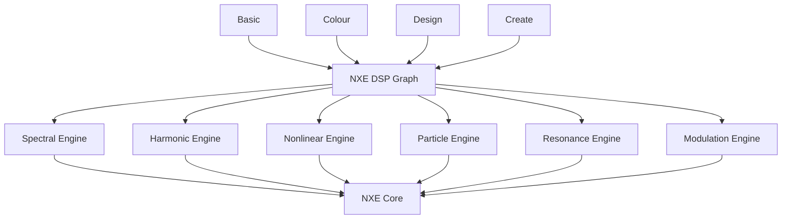

# NXE Plugin Series — 製品企画集

## 1. ブランド構成

NXEは音響処理・音響合成の技術を、実用的な制作ツールから実験的なサウンドデザインまで展開するブランド。

| シリーズ | 役割 | 対象 |
|---|---|---|
| Basic | 音を整える | 汎用ミックス・音質改善 |
| Colour | 音に色彩と生命を与える | Colour Bass、Botanica、Future Riddim、アンビエント |
| Design | 音響構造を書き換える | Bass、Neurofunk、Dubstep、D&B、実験的なシンセ加工 |
| Create | 新しい発音原理を提供する | 特定の音色・合成方式に特化した楽器 |

ブランドコピー案：**NXE — Beyond the Shape of Sound.**（音の形、その先へ。）

### 確定事項と留意点

- Sparkluerは開発済みで、Basicシリーズに所属する。Colourには重複配置しない。
- Chromaはコンセプトとして有望だが既存製品との名称重複が指摘された。Diffractを発展案・改名候補とする。
- 以下のその他の名称・仕様は企画段階。商標、既存製品との重複、研究上の新規性、DSPの実現性は未検証。
- 初期案と発展案は両方残し、統合候補を明記する。優先順位は提案であり決定事項ではない。

## 2. Basic Series

### Sparkluer — Multiband Harmonic Enhancer【開発済み】
OTT的なマルチバンド処理と煌びやかな質感を組み合わせる製品。過去の企画案では上下方向コンプレッション、倍音生成、粒子的な高域拡散、帯域別ステレオ処理、Transient Sparkleが挙がった。実装済み製品の正確な仕様は本資料では未確認。

## 3. Colour Series

### 初期案

| 製品 | コンセプト・DSP |
|---|---|
| Chroma | Polyphonic Spectral Colorizer。MIDI・コードに基づくスペクトル再合成、倍音マッピング、フォルマント・トランジェント保持。名称変更候補あり。 |
| Liquefy | Liquid Spectral Processor。周波数依存ディレイ、スペクトル拡散、流体的変調、共振フィルター、粒状トランジェント。 |
| Flora | Organic Texture Generator。グラニュラー、確率的倍音生成、自己相関モジュレーション、成長と減衰。 |
| Prisma | Polyphonic Resonance Engine。MIDI制御のポリフォニック共振、非整数倍音、共振器間結合、Decay。原音に響きを重ねる。 |
| Aether | Spectral Harmonic Reverb。周波数別Decay、フリーズ、コードクオンタイズ、倍音変換、グラニュラー残響。 |

### ピーキーな発展案

#### Diffract — Harmonic Diffraction Processor
音を分光するように周波数成分を和声構造へ分配・再配置する。Chromaの発展案。ノイズや無調性Bassから、和音と複雑な質感が一体化したColour Bassを作る。

- DSP：STFT、倍音マッピング、スペクトル再合成、周波数依存ディレイ。
- Dispersion：構成音間への倍音分散量。
- Purity：非調和成分の残存量。
- Refraction：倍音マッピングの歪み。
- Separation：構成音間の空間的分離。
- Drift：構成音間の時間差・揺らぎ。
- Recombine：分解した音の再結合。

#### Meniscus — Liquid Surface Processor
表面張力を模した音響挙動。トランジェントで共振周波数を急変させ、揺れながら安定させる。水滴、泡、ゼリー状のBassに特化。DSP：減衰振動、非線形共振、時間変動コムフィルター。

#### Effloresce — Harmonic Particle Disperser
倍音単位で音を微細な粒子に変換して空間へ拡散する。音程を保ちつつPluckから結晶的な粒を飛散させる。DSP：正弦波トラッキング、粒子再合成、確率的空間分布。

#### Synesthesia — Dynamic Harmonic Transmutation
音量、倍音、スペクトル重心などの特徴量に応じて和声を変化させる。maj7、sus2、add9などを連続的に移行するBass。DSP：特徴量解析、動的和声マッピング、スペクトル補間。

#### Mycelia — Recursive Organic Resonator
共振器同士が励起し合い、エネルギーが枝分かれして伝播する。入力停止後も有機的な残響が成長する。DSP：動的共振器ネットワーク、結合振動子、非線形フィードバック。

#### Nacre — Spectral Interference Colorizer
真珠やシャボン玉の構造色を音響的に再解釈する。微小ディレイと位相干渉によるスペクトル模様を時間・音程に応じて変化させる。DSP：多段オールパス、時間変動位相干渉、周波数依存フィードバック。

### 小型プラグイン案

| 製品 | 機能 |
|---|---|
| Dew | 水滴状の倍音トランジェント付加 |
| Glint | トランジェントから結晶的な高域生成 |
| Nectar | 滑らかで粘性のある倍音モーフィング |
| Pollen | 音程を維持した微細粒子拡散 |
| Halo | 原音の周囲に調性的残響を生成 |
| Prismatica | 帯域別の和音化 |

## 4. Design Series

### 初期案

| 製品 | コンセプト |
|---|---|
| Morph | 2音源のスペクトル、位相、フォルマント、時間包絡を個別に融合。サイドチェインと帯域別Morph。 |
| Fracture | 時間・周波数断片の並べ替え、反転、位相断片化、FFTビン反転、マルチバンドGranular、BPM同期Glitch。 |
| Mutate | DSP構成やパラメーターを変異させ、派生音を試聴・選択して世代を重ねる進化的サウンドデザイン。 |
| Devour | 波形整形、位相変調、フィードバック、ダイナミクスを組み合わせるBass専用非線形処理。Sub Protection、Harmonic Targeting。 |
| Warp | 周波数の移動先をカーブで編集。倍音圧縮・拡張、非線形周波数マッピング、帯域別ピッチシフト。 |
| Formant | 喋るBassや生物的Growl向けフォルマント加工。 |
| Kinetic | 静的な音に複雑な動きを付けるマルチモジュレーション。 |
| Impact | Bass・Drumの重量感と攻撃性を操作するトランジェント加工。 |
| Fold | 波形の折り畳みによる複雑な倍音生成。 |
| Reform | NXEのDSPをノード接続できる統合サウンドデザイン環境。 |

Mutateの操作案：Mutation Strength、Complexity、Aggression、Musicality。生成AIを必須とせず進化的アルゴリズムで実装可能。

Reformの構成案：Audio Input → Spectral Warp／Granular Texture等の並列経路 → Shaper／Resonator → Mixer。共通モジュレーションと各シリーズのDSPを再利用する。ブランド成長後の上位製品候補。

### ピーキーな発展案

#### Topology — Waveform Structure Designer
波形の山・谷・ゼロ交差・曲率など時間的、幾何学的構造を直接変形。Peak Position、Curvature、Asymmetry、Zero Crossing、Segment Stretch。ピッチ追従モードと非周期信号向けモードを想定。

#### Parasite — Parasitic Oscillation Processor
入力のピッチ・位相に追従する寄生発振器で原音を変調する。後掛けFMに近い使い方を狙う。

| パラメーター | 動作 |
|---|---|
| Infection | 寄生発振器の影響量 |
| Species | 合成方式 |
| Hunger | 原音から寄生音へのエネルギー移行量 |
| Spread | 増殖範囲 |
| Resistance | 原音構造の保持 |
| Mutation | 時間的変化 |

#### Singularity — Spectral Gravity Processor
周波数空間に仮想重力源を置き、スペクトル成分を移動させる。Attraction（吸引）、Repulsion（反発）、Orbit（周期移動）、Collapse（収束）、Tidal Force（倍音間隔変形）。MIDIで重力源を制御する案。

#### Dislocate — Harmonic Time Manipulator
倍音単位で異なる時間軸を与える。高域の先行、奇数倍音の逆再生、特定倍音のフリーズ、包絡の異速度再生。先読み・逆再生などはバッファとレイテンシーを要する。

#### Hysteresis — Stateful Nonlinear Processor
過去の入力状態で歪み方が変わる非線形処理。磁気ヒステリシス、粘弾性、熱蓄積、非線形フィードバックをモデル化し、アナログ再現にとどまらず極端な音作りに利用する。

| その他の発展案 | コンセプト |
|---|---|
| Corrode | 倍音構造を徐々に侵食・崩壊させる |
| Mimic | 別の音の音響的特徴を移植する |
| Symmetry | 波形・スペクトルの対称性を操作する |
| Rupture | 波形の断裂点から新しい倍音を生成する |
| Entangle | 複数の周波数帯域を相互変調する |
| Vortex | 周波数方向に循環するフィードバック |
| Articulate | Bassを発音・発声するように動かす |

### 小型プラグイン案

| 製品 | 機能 |
|---|---|
| Decouple | 倍音と基音の動きを分離 |
| Shear | スペクトルを斜め方向に時間変形 |
| Invert | スペクトルの周波数配置を反転 |
| Torque | 周期内位相の非線形変形 |
| Buckle | 入力強度に応じた急激な波形変形 |
| Fever | 時間とともに不安定になる歪み |
| Bifurcate | 発振・フィードバックの分岐現象を利用 |
| Afterimage | 過去のスペクトルを残像として重ねる |
| Isotope | 倍音構造を保ったまま音を変異させる |

## 5. Create Series

万能シンセではなく、特徴的な音を発音段階から作る専用シンセ。各製品に固有の合成原理・操作体系を持たせる。

### Iridesce — Colour Bass / Chord-Object Synthesizer
和音全体を一つの発振オブジェクトとして扱う。構成音同士の相互変調、加算合成、スペクトル合成、倍音マッピング、FMにより、Bassとコードを一体化する。コード自体をウェーブテーブルのように変形する構想。

| パラメーター | 動作 |
|---|---|
| Colour | 無調性から和音主体への変化 |
| Movement | スペクトルの時間変化 |
| Density | 倍音密度 |
| Voicing | コードのボイシング |
| Unity | 構成音間の変調同期 |
| Aggression | 非線形処理の強度 |

### Bloom — Organic Generative Synthesizer
植物の成長を模したBotanica音源。物理モデリング、グラニュラー、確率的発音、共振器ネットワーク。Seed、Growth、Branching、Bloom、Decayで発音の増殖、音程・時間・空間の揺らぎを操作する。

### その他の初期案

| 製品 | コンセプト・合成方式 |
|---|---|
| Chimera | Neuro Bass／Growl／Reese特化。フィードバックFM、位相変調、非線形フィルター、フォルマント合成。 |
| Alloy | 金属的なTearout／Riddim Bass。モーダル合成、非整数倍音、共振器間変調、金属物理モデル。 |
| Quanta | 粒子の集合による音響合成。Pulsar、マイクロサウンド、確率的変調。 |
| Glacia | ガラス・氷・結晶のPluck／Bell／Keys。モーダル合成、Waveguide、加算合成。 |
| Anomaly | カオス発振器、非線形微分方程式、結合振動子、アトラクター変調。 |

### ピーキーな発展案

#### Rhizome — Recursive Growth Synthesizer
一つの発音から再帰的に新しい発音が枝分かれする。音色だけでなく増殖規則を編集する。植物的Pluck、有機的アルペジオ向け。Bloomの発展・統合候補。

#### Capillary — Fluid-Inspired Synthesizer
水滴、泡、液体衝突を近似した合成。粘性、密度、圧力、表面張力を操作。Liquid Bassや水系Pluck向け。

#### Phoneme — Alien Vocal Bass Synthesizer
架空生物の声帯、喉、口腔、舌に相当する音響モデルを設計する。Talking BassやGrowlに特化。

#### Cymatica — Geometric Resonance Synthesizer
板、膜、リングなどの形状、材質、厚さ、張力、励起位置に基づく固有振動モードによる合成。現実にない材質やモード間変調も扱う。

運動方程式：

$$M\ddot{u}+C\dot{u}+Ku=f(t)$$

有限要素法等でモードを事前計算し、リアルタイムではモーダル合成を行う案。負の減衰を扱う場合は飽和や安定性制御が必要。

#### Attractor — Chaotic Dynamics Synthesizer
周期運動、準周期運動、カオスを連続的に移行する発振器。Anomalyの発展・統合候補。安定Bassから暴走する質感まで扱う。

#### Swarm — Collective Oscillator Synthesizer
数百〜数千の発振器が群れとして相互作用し、同期・分裂する。巨大なReese、粒状Pad、群体的Leadに特化。Kuramotoモデルをベースとする案。

$$\frac{d\theta_i}{dt}=\omega_i+\frac{K}{N}\sum_{j=1}^{N}\sin(\theta_j-\theta_i)$$

- Cohesion：群れのまとまり。
- Alignment：位相同期強度。
- Separation：周波数分離。
- Population：個体数。
- Speciation：発振器群の分裂。
- Turbulence：不規則な動き。

全対全結合の計算負荷を抑えるため平均場表現等を検討する。

#### Shard — Discontinuous Wave Synthesizer
波形の断片や不連続点を積極的に設計して硬質なBassを作る。不連続性の帯域制限を行い、Tearout、Riddim向けの鋭い音を生成する。

## 6. 共通DSPアーキテクチャ案

| エンジン | 技術・責務 |
|---|---|
| Spectral | FFT / STFT / スペクトル再合成 |
| Harmonic | 加算合成、ピッチ解析、コード処理 |
| Nonlinear | Waveshaping、Folding、Feedback |
| Particle | Granular、確率的発音、微小粒子 |
| Resonance | Modal、Waveguide、FDN、結合共振器 |
| Modulation | LFO、Envelope、Chaos、共通変調 |
| DSP Graph | Processing、Routing、Modulation、Voice Management |
| Core | SIMD、Oversampling、メモリ管理、Audio Buffers、Parameters |

共通UI：モジュレーション、プリセットブラウザー、スペクトルビジュアライザー、マクロコントロール。実装時にはリアルタイム安全性、エイリアシング、レイテンシー補償、フィードバック安定性も検討する。

## 7. 製品の整理・開発優先度

### 統合・差別化候補（編集上の提案）

| 関連製品 | 整理方針 |
|---|---|
| Chroma / Diffract | 同一製品の発展案として扱い、Diffractを仮称候補とする |
| Liquefy / Meniscus / Capillary | 流体的FX、表面張力特化FX、専用音源として差別化 |
| Flora / Mycelia / Bloom / Rhizome | 入力加工と発音生成を分離。BloomとRhizomeは統合候補 |
| Prisma / Prismatica / Diffract | 共振付加、帯域別和音化、スペクトル再配置で区別 |
| Morph / Mimic | 双方向融合と特徴移植で区別 |
| Warp / Singularity | カーブ編集と重力モデルで区別 |
| Formant / Articulate / Phoneme | フォルマント加工、発声的動作、専用合成音源で区別 |
| Anomaly / Attractor | 統合候補 |
| Alloy / Glacia / Cymatica | 攻撃的金属音、透明な結晶音、汎用幾何学共振という用途で区別 |
| Quanta / Swarm | 微小時間粒子の集合と結合発振器群で区別 |

### 初期のロードマップ案（履歴）
Chroma → Sparkluer → Devour → Liquefy → Prisma → Morph → Iridesce → Mutate → Bloom → Reform。Sparkluerは既に完成しているため、今後の開発対象から除外する。

### 最新の有望候補

| 製品 | 独自性（主観） | 実用性（主観） | 難易度（概算） |
|---|---|---|---|
| Diffract | 4/5 | 5/5 | 高 |
| Meniscus | 5/5 | 4/5 | 中〜高 |
| Effloresce | 5/5 | 4/5 | 高 |
| Parasite | 5/5 | 5/5 | 中〜高 |
| Topology | 4/5 | 5/5 | 中〜高 |
| Singularity | 5/5 | 4/5 | 高 |
| Dislocate | 5/5 | 4/5 | 高 |
| Iridesce | 5/5 | 5/5 | 非常に高 |
| Rhizome | 5/5 | 4/5 | 高 |
| Swarm | 5/5 | 4/5 | 高 |
| Cymatica | 5/5 | 4/5 | 非常に高 |

特に推した候補：**Parasite、Diffract、Swarm、Meniscus**。

フラッグシップ候補：Colour = Diffract、Design = Mutate（Parasiteも有力）、Create = Iridesce。Bloom／RhizomeもBotanica向けの重要候補。

評価は企画段階の主観的な見立てであり、実装・試聴・競合調査によって更新する。
